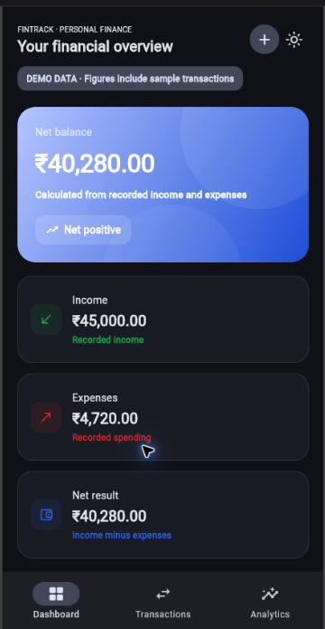
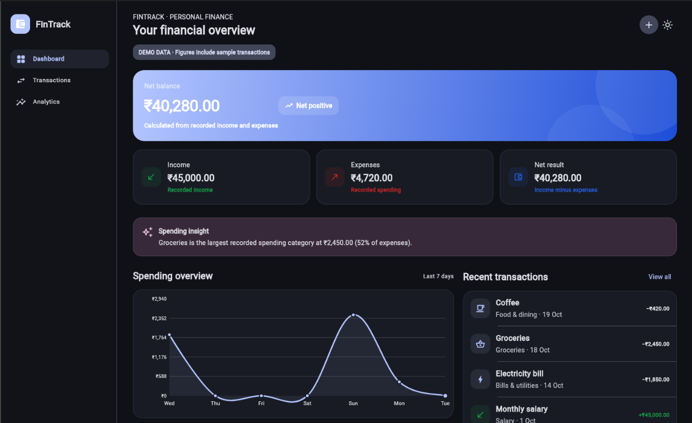
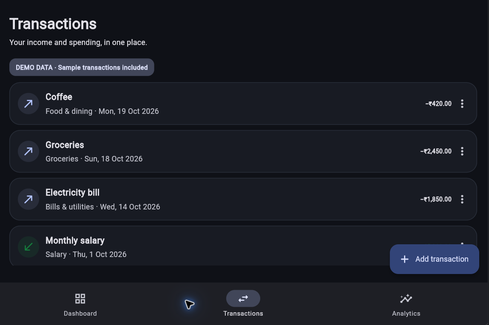

# Personal Finance Tracker

A Flutter personal finance tracker for recording income and expenses, viewing calculated balances, and reviewing spending activity. The project uses a feature-first structure and is being developed in small, verified milestones.

## Current Features

- Responsive dashboard with net balance, income and expense totals, a seven-day spending chart, recent transactions, and the largest recorded expense category.
- Transaction management with add, edit, delete, category, date, type, and amount validation.
- Analytics screen and light, dark, and system theme modes.
- INR formatting and sample data clearly labeled in the dashboard.

Transactions currently live in memory. The sample transactions are for demonstration and reset when the app is restarted; persistent storage and live financial data are not implemented.

## Dashboard Evidence

The screenshots show the running Flutter web dashboard at mobile and desktop widths. The implementation and state logic are available in [dashboard_screen.dart](lib/features/dashboard/dashboard_screen.dart), [finance_controller.dart](lib/features/transactions/finance_controller.dart), and [finance_transaction.dart](lib/features/transactions/finance_transaction.dart).



*Mobile dashboard, 360 × 695 capture.*



*Desktop dashboard, 1242 × 761 capture.*

The transaction list is shown at desktop width:



*Transactions screen, 1150 × 765 capture.*

### Source Evidence

The dashboard derives its displayed totals and chart data from the shared transaction controller:

```dart
final recentTransactions = finance.transactions.take(4).toList();
final dailySpending = _dailySpendingForLastWeek(finance);
final categoryTotals = finance.expenseTotalsByCategory.entries.toList()
  ..sort((a, b) => b.value.compareTo(a.value));
```

See the [dashboard implementation](lib/features/dashboard/dashboard_screen.dart) and [transaction controller](lib/features/transactions/finance_controller.dart) for the complete code.

## Experiment 1 Dart Basics

The standalone Dart demonstration uses typed variables, a `LedgerEntry` class, a reusable total function, a list, a set, a map, loops, and a switch expression. It uses finance examples without creating another Flutter application.

Run it with:

```powershell
dart run tool/dart_basics.dart
```

The command completed successfully. Its captured output is available in [dart-basics-output.txt](docs/evidence/dart-basics-output.txt), and the [Dart source](tool/dart_basics.dart) is part of this repository.

## Experiment 2 Flutter Widgets and Layouts

The dashboard composes `Text`, `Icon`, `Container`, `Row`, and `Column` widgets. Its balance card uses `Stack` and `Positioned` for restrained decorative layers, as shown in the [desktop dashboard capture](docs/screenshots/dashboard-desktop.png). When a fresh tracker has no entries, the Transactions screen displays the local [empty-ledger illustration](assets/illustrations/empty_ledger.png) through `Image.asset`; the asset is declared in `pubspec.yaml` and does not require a network connection.

```dart
Image.asset(
  'assets/illustrations/empty_ledger.png',
  width: 176,
  height: 124,
  fit: BoxFit.contain,
)
```

The [Transactions screen](lib/features/transactions/transactions_screen.dart) contains this image widget. A widget test verifies that the empty state loads the local asset without an exception. The dashboard screenshot demonstrates the layered `Stack` layout; it does not show the empty state.

## Experiment 3 Responsive UI

The app switches from bottom navigation to a sidebar at 1100 logical pixels. The dashboard uses `LayoutBuilder` to arrange spending and recent transactions in columns on wider layouts and adjusts its summary grid from one to three columns:

```dart
final columns = switch (constraints.maxWidth) {
  >= 900 => 3,
  >= 560 => 2,
  _ => 1,
};
```

See the [dashboard layout source](lib/features/dashboard/dashboard_screen.dart). The [mobile capture](docs/screenshots/dashboard-mobile.png) is 360 × 695; the [desktop capture](docs/screenshots/dashboard-desktop.png) is 1242 × 761. A widget test lays out both viewport sizes, checks the expected navigation at each width, and verifies that neither layout throws.

## Experiment 8 Animations

When a saved transaction changes the net balance, the dashboard uses `AnimatedSwitcher` for a 240 ms fade and short vertical slide. It reads `MediaQuery.disableAnimationsOf(context)` and removes the transition when the platform requests reduced motion. The widget test checks that the old and new balance values overlap during the transition and that the final amount is correct. The desktop screenshot shows the settled dashboard state; a static screenshot cannot show the motion itself.

## Verification

At the widget/layout milestone, Flutter static analysis and the complete widget/controller test suite passed:

```powershell
flutter analyze --no-pub
flutter test --no-pub
```

Recorded results at the current milestone: `No issues found!` and `All tests passed!` (12 tests).

## Run Locally

Install the Flutter SDK, then run these commands from the project directory:

```powershell
flutter pub get
flutter run -d chrome
```

To use Flutter's web server instead, run `flutter run -d web-server` and open the localhost URL it prints.

## Project Structure

```text
lib/
├── app/                 # App setup, routes, and theme
├── features/
│   ├── analytics/       # Analytics screen
│   ├── dashboard/       # Dashboard and spending chart
│   └── transactions/    # Transaction model, state, and screens
└── main.dart

test/                    # Widget and controller tests
docs/screenshots/        # Runtime evidence
```

## Current Limitations

- Transaction state is in memory and is lost when the app restarts.
- The dashboard sample data is illustrative and is not linked to a bank or external API.
- Budgets, persistent storage, and production deployment are future work.
